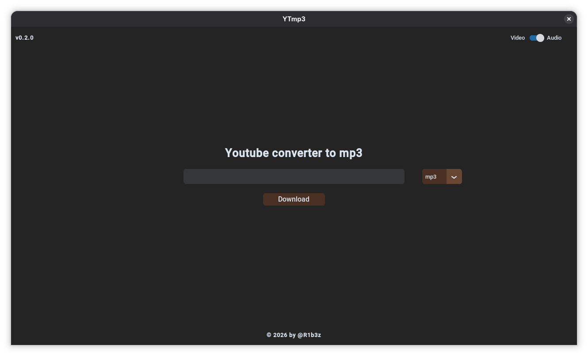

<div align="center">
  
# YTmp3 


</div>

## App



## What the program uses

- **Python 3** to execute the application.
- **CustomTkinter** to create the graphical interface.
- **yt-dlp** to obtain the video audio.
- **FFmpeg** to convert the audio into MP3. FFmpeg needs to be installed and available in `PATH`.

## How it works

Introducing a YouTube URL in the textbox and clicking the button triggers the app to start the process in the background, it then creates a `downloads` folder in the current directory if there isn't already one, presents the location/filename in the screen and saves the converted file in the `downloads` folder.

The application only accepts URL's in the following format: `https://www.youtube.com/watch?v=...` and processes one video at a time.

It uses threads to fetch and convert the video seperately from the main thread so the UI is rendering without being interrupted.

## Requirements

- Windows/Linux
- Python 3 installed and available in `PATH`
- FFmpeg installed and available in `PATH`
- Internet connection

## Installation

Install the Python dependencies with:

```bash
python -m pip install yt-dlp customtkinter
```

Install FFmpeg separately, following the instructions for your system, and confirm the command `ffmpeg` is available in `PATH`.

## Executing

For windows, I created a .bat so the app can be start just by running `ytmp3.bat`. Alternatively, execute the following in the project directory:

```bash
python main.py
```

## Structure

- `main.py` — graphical interface and transfer/conversion logic.
- `ytmp3.bat` — shortcut to start the app on Windows.
- `downloads/` — destination folder for the MP3 files.

## App

- ### UI Feedback


- ### Workflow


## Note

Only use the app with contents that you have the right to download and respect YouTube terms of service and applicable copyrights.
